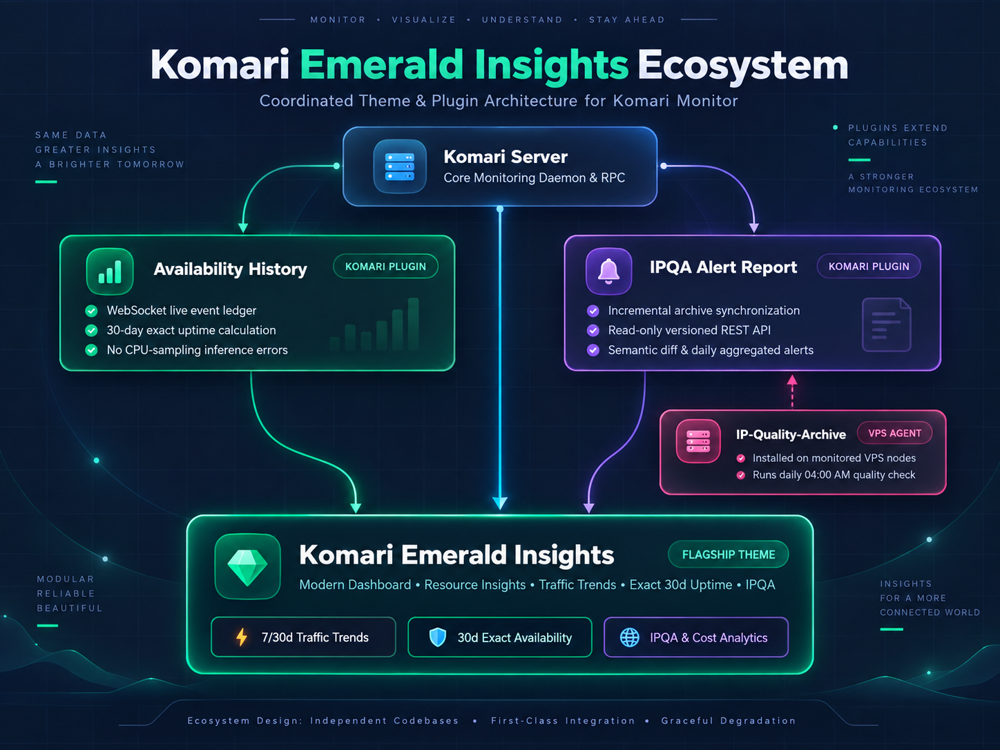

# Komari Emerald Suite

  <strong>面向 Komari 的主题与插件配套生态。</strong> 
  <em>A coordinated theme and plugin ecosystem for Komari.</em>

  
  
  

---

## 架构概览 (Architecture Overview)

Komari Emerald Ecosystem 采用**独立代码库、松耦合、优雅降级**的设计。无需合并代码库或引入重量级单体依赖，各组件即可协同提供高颜值的监控前端与专业的可用性、网络质量数据能力。

---

## 生态项目矩阵 (Ecosystem Projects)

### 1. [Komari Emerald Insights](https://github.com/Chen017/komari-theme-emerald-insights) (前端主题)

- **仓库地址**：[Chen017/komari-theme-emerald-insights](https://github.com/Chen017/komari-theme-emerald-insights)
- **核心能力**：
  - **经典监控**：轻量精致的节点网格与详情视图。
  - **每日流量趋势**：7 天 / 30 天 / 本周期流量汇聚，平滑处理重启与计数器重置。
  - **近 30 天在线率**：无缝消费 Availability History 账本，展示真实覆盖率。
  - **CPU Steal 原生叠加**：可选消费 CPU Steal Monitor 的两分钟历史数据，在既有 CPU/负载图上呈现 Steal%，共享实时与历史时间轴。
  - **IP 质量概览**：无缝消费 IPQA 归档，提供节点质量卡片、风险矩阵、流媒体/AI 解锁矩阵与逐日档案回溯。
  - **成本与续费**：多币种汇率统一折算、月均与年度预算分析及续费时间轴。

---

### 2. [Availability History](https://github.com/Chen017/komari-plugin-availability-history) (在线率账本插件)

- **仓库地址**：[Chen017/komari-plugin-availability-history](https://github.com/Chen017/komari-plugin-availability-history)
- **定位**：精准在线率事件提供方。
- **核心能力**：
  - **事件账本**：基于 WebSocket 实时断连事件记录真实离线。
  - **防 Flapping**：可配置离线宽限期，避免短时网络抖动造成误报。
  - **维护停机隔离**：服务端维护或插件重启标记为 `UNOBSERVED`，不计入 VPS 故障。
  - **标准 API**：直接暴露 `GET /api/plugin/availability-history/v1/summary` 供前端渲染。

---

### 3. [IPQA Alert Report](https://github.com/Chen017/komari-plugin-ipqa-alert-report) (IP 质量平台插件)

- **仓库地址**：[Chen017/komari-plugin-ipqa-alert-report](https://github.com/Chen017/komari-plugin-ipqa-alert-report)
- **定位**：IPQA 数据中枢、只读 API 提供方与日常告警聚合推送器。
- **核心能力**：
  - **增量归档同步**：同步各 VPS 节点 `~/.ipqa/data` 归档文件到服务端。
  - **只读 REST API**：挂载 `/api/plugin/ipqa-alert-report/v1`，访客端请求纯读缓存。
  - **语义差异引擎**：每日自动对比相邻归档，精准捕获归属、评分、流媒体解锁与 DNSBL 变更。
  - **聚合告警通知**：每日定时聚合推送至 Telegram 等通道。

---

### 4. [CPU Steal Monitor](https://github.com/Chen017/komari-plugin-cpu-steal-monitor)（CPU 抢占率监控插件）

- **仓库地址**：[Chen017/komari-plugin-cpu-steal-monitor](https://github.com/Chen017/komari-plugin-cpu-steal-monitor)
- **定位**：**可独立运行的 CPU Steal 数据采集、时间序列与 API 服务**；推荐与 Emerald Insights 主题联动，但不依赖主题。
- **核心能力**：
  - **两分钟只读采集**：直接使用 Komari 现有 Agent 远程命令读取 Linux /proc/stat，不安装额外 VPS 常驻进程。
  - **准确的 Steal 百分比**：根据两个累计计数器快照求差，保留实际采样时间范围、断连和重启缺口；Steal 0% 与无数据分开。
  - **独立 API**：提供 `/v1/history`（逐区间历史）、`/v1/summary`（最新/平均/最大值及覆盖率）、管理员 `/v1/health`（诊断）。
  - **主题联动**：为 Emerald Insights 的 CPU / Load Average 双轴图叠加 Steal（2 分钟均值），兼容现有历史图表时间桶。
- **要求**：Komari Agent 必须允许远程命令执行；如果关闭了 Agent 远程命令权限，本插件无法获取 Steal。
- **安装关系**：只要独立 Steal API，**仅安装插件**即可；需要图表叠加，再安装 Emerald Insights 主题。

---

### 5. [Line Quality Monitor](https://github.com/Chen017/komari-plugin-line-quality-monitor)（线路质量监控插件）

- **定位**：按 VPS 与 Ping 任务自动学习延迟和波动。
- **通知**：通过 Komari 官方渠道提醒反复跳动、持续变慢、阶段性改善和恢复。
- **搭配**：插件可独立使用，推荐搭配 Emerald Insights，在节点详情查看 Ping 延迟和丢包趋势。

---

### 6. [IP-Quality-Archive](https://github.com/Chen017/IP-Quality-Archive) (外部依赖 / VPS 采集器)

- **仓库地址**：[Chen017/IP-Quality-Archive](https://github.com/Chen017/IP-Quality-Archive)
- **定位**：运行于被监控 VPS 节点的轻量级质量检测与建档工具。
- **与生态的关系**：各 VPS 节点每天自动执行 IPQA 检测并生成归档，由 `komari-plugin-ipqa-alert-report` 定时拉取并交由 `komari-theme-emerald-insights` 呈现。

---

## 快速安装组合推荐

| 需求场景 | 安装推荐 |
| :--- | :--- |
| **基础监控 + 高颜值主题** | `komari-theme-emerald-insights` |
| **需要 30 天精确可用性与在线率** | `komari-theme-emerald-insights` + `komari-plugin-availability-history` |
| **只需独立 CPU Steal 数据/API** | `komari-plugin-cpu-steal-monitor`（不依赖主题） |
| **需要在 CPU/负载图中叠加 Steal** | `komari-plugin-cpu-steal-monitor` + `komari-theme-emerald-insights` |
| **需要集群 IP 质量监测与风险矩阵** | `komari-theme-emerald-insights` + `komari-plugin-ipqa-alert-report` + VPS 安装 `IP-Quality-Archive` |
| **需要线路波动、退化和改善通知** | `komari-plugin-line-quality-monitor`，可搭配 Emerald Insights 查看 Ping 图 |
| **完整全能生态体验** | **主题 + 四款 Komari 插件**，需要 IPQA 时在 VPS 安装 IP-Quality-Archive |

---

## 许可证 (License)

本项目采用 [MIT License](LICENSE) 协议开源。
各子项目遵循其各自仓库中的开源协议。
